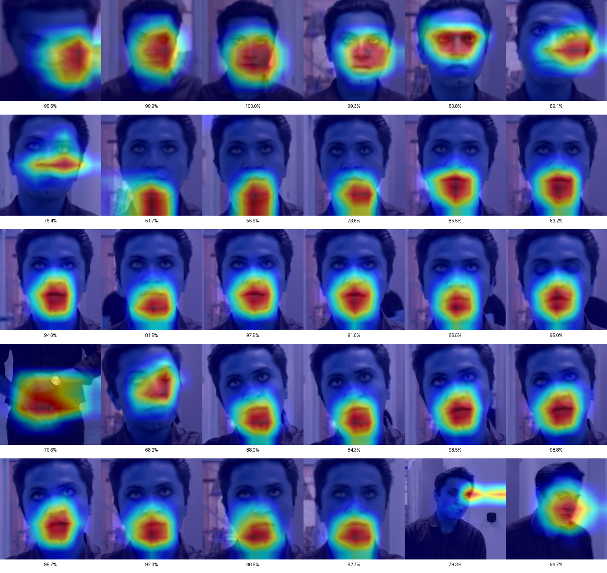
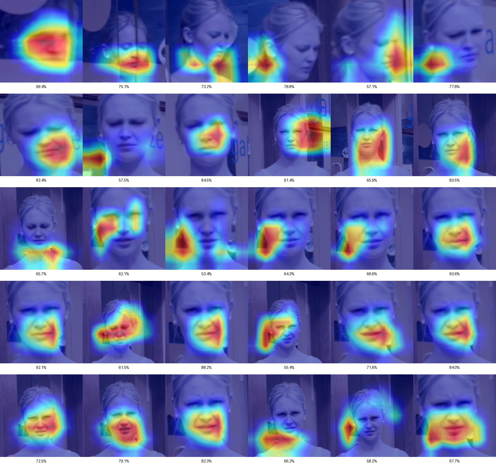
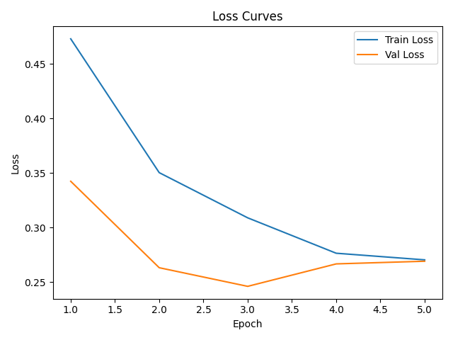

# Deepfake Video Detection

Detect **deepfake videos** by classifying individual frames with deep
learning models and combining the frame predictions into one decision
per video.

Three architectures are compared, each trained in two ways:

- on **face crops**, where the face is detected and cropped from every
  frame
- on **full frames**, where the whole image is used and no face detection
  is needed

Each trained model is then tested on **both** input types. This shows
how well a model trained on one view generalizes to the other. Grad-CAM
heatmaps show which regions of the image each model relies on.



## How it works

```
video ──► sample 30 frames ──► [crop face] ──► CNN / Transformer ──► P(fake) per frame
                                                                          │
                              real / fake ◄── aggregate per video ◄───────┘
```

1. **Frame sampling:** 30 frames per video, at equal intervals.
2. **Face cropping** (face pipeline only): faces are detected with
   [MediaPipe](https://github.com/google-ai-edge/mediapipe) (short- and
   full-range models), with [MTCNN](https://github.com/timesler/facenet-pytorch)
   as a fallback. Each face is cropped with a 20% margin and resized to
   224×224. Frames without a detected face are skipped.
3. **Frame classification:** a pretrained backbone, fine-tuned for
   real/fake classification.
4. **Video-level aggregation:** the frame predictions are combined with
   one of six methods: mean, max, min, median or trimmed mean of the fake
   probability, or the percentage of frames voted fake. During training,
   the method with the best validation F1-score is chosen. The test set
   is then evaluated with that method.

### Models

| Model | Backbone | Additions | Fine-tuning |
|-------|----------|-----------|-------------|
| **ResNet50** | torchvision ResNet50 (ImageNet) | MLP head (512 → 2, dropout 0.5) | Layers 2-4 + head |
| **Xception** | timm Xception (ImageNet) | Squeeze-and-Excitation block on the final feature map | Blocks 6-8, last conv + SE + head |
| **Swin Transformer** | timm Swin-Base, patch 4, window 7 (ImageNet) | SE block on the pooled features + MLP head | Last stage, with gradual unfreezing of earlier stages |

### Training

| Setting | Value |
|---------|-------|
| Split | 75% train, 12.5% validation, 12.5% test (by video, fixed seed) |
| Epochs | 5, with early stopping on validation loss |
| Batch size | 8 |
| Learning rate | 1e-4, reduced on plateau |
| Optimizer | Adam (ResNet50, Xception) / AdamW (Swin) |
| Precision | Mixed precision (AMP) |
| Augmentation | Random crop, horizontal flip, rotation, color jitter (training only) |

### Experiments

Every model runs four experiments:

| Trained on ↓ / Tested on → | Faces | Frames |
|----------------------------|-------|--------|
| **Faces** | `faces_on_faces` | `faces_on_frames` |
| **Frames** | `frames_on_faces` | `frames_on_frames` |

Each test reports the video-level accuracy, precision, recall, F1-score,
Matthews correlation coefficient (MCC), average precision (AP) and equal
error rate (EER).

## Explainability

For up to 3 videos of each outcome (true/false positive, true/false
negative), a 5×6 grid of Grad-CAM heatmaps is saved, one per sampled
frame. Each frame is labeled with the model's confidence in its
prediction.

On a correctly detected fake (image above), Xception focuses consistently
on the **mouth region**, where face-swap artifacts are common. On a fake
it missed (below), the attention is scattered over the background and
the edges of the face.



## Dataset

The project uses 400 videos (200 real, 200 fake) from the **DeepFake
Detection** subset of [FaceForensics++](https://github.com/ondyari/FaceForensics).
The dataset is not included in this repository because its terms of use
do not allow redistribution. Request access through the FaceForensics++
repository, then place the videos like this:

```
Dataset/
├── real/   # 200 original .mp4 videos
└── fake/   # 200 manipulated .mp4 videos
```

The folders are set in [`utils/constants.py`](utils/constants.py), along
with the other settings (frames per video, epochs, batch size, split
ratios).

## Pre-trained weights

The trained weights of all six models are available on the
[Releases](../../releases) page:

| File | Model | Trained on |
|------|-------|------------|
| `resnet50_faces.pth` | ResNet50 | Face crops |
| `resnet50_frames.pth` | ResNet50 | Full frames |
| `xception_faces.pth` | Xception | Face crops |
| `xception_frames.pth` | Xception | Full frames |
| `swin_transformer_faces.pth` | Swin Transformer | Face crops |
| `swin_transformer_frames.pth` | Swin Transformer | Full frames |

## Project structure

```
deepfake-video-detection/
├── main.py                    # Runs all trainings and the 4 tests per model
├── models/
│   ├── resnet50.py            # ResNet50 model, training and validation
│   ├── xception.py            # Xception + SE model, training and validation
│   └── swin_transformer.py    # Swin Transformer + SE model, training and validation
├── utils/
│   ├── constants.py           # Paths and hyperparameters
│   ├── prepare_data.py        # Frame sampling, face cropping, datasets, transforms
│   └── evaluate_models.py     # Video-level testing, metrics, plots, Grad-CAM
└── docs/images/               # Images used in this README
```

## Getting started

A CUDA GPU is strongly recommended. Training all six models on the
full dataset takes several hours.

```bash
git clone https://github.com/ApostolosVarelas/deepfake-video-detection.git
cd deepfake-video-detection
python -m venv .venv
# Windows: .venv\Scripts\activate   |   macOS/Linux: source .venv/bin/activate
pip install -r requirements.txt
python main.py
```

Requires **Python 3.12** or lower, because mediapipe has no wheels for
newer versions. For GPU support, install the CUDA build of PyTorch 2.2.2
that matches your system. See
[pytorch.org](https://pytorch.org/get-started/previous-versions/).

### Output

Everything is written to `output/`:

```
output/
├── DeepFakeDetection.log
└── <Model>/
    ├── faces/training/          # Weights, validation metrics, training curves
    ├── frames/training/
    └── <train>_on_<test>/testing/
        ├── <Model>_metrics.txt              # Video-level metrics
        ├── <Model>_correct.csv / _errors.csv  # Per-video predictions
        ├── <Model>_confusion_matrix.png
        ├── <Model>_roc_curve.png
        ├── <Model>_pr_curve.png
        └── cams/{TP,TN,FP,FN}/              # Grad-CAM heatmap grids
```



## Built with

PyTorch, torchvision, timm, MediaPipe, facenet-pytorch (MTCNN), OpenCV,
pytorch-grad-cam, scikit-learn, matplotlib and seaborn.
